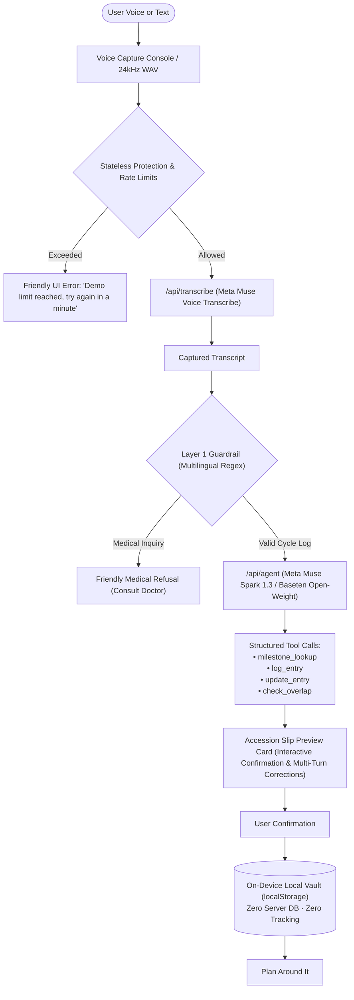

# Feather — Voice-First Menstrual Cycle Companion

**Live demo:** https://feather-w.vercel.app
<!-- DEMO VIDEO LINK: add here -->
Meta Global AI Developer Hackathon · Indie Developer · Build for Your World

> **One-Sentence Pitch:** Feather is a private, voice-first menstrual companion that turns fuzzy recollections like *"two days before New Year's"* into structured cycle logs and honest event overlap estimates using Meta Muse Voice & Spark. Cycle data is stored only on your device; voice and text are sent to Meta's API for processing when you use those features.

## What Feather does
- Voice logging with Meta Muse Voice Transcribe (`muse-voice-transcribe-1.0`): speak an entry, review the Accession Slip, confirm to save.
- Landmark Recall: phrases such as "two days before Onam" are resolved to real dates by a Muse Spark tool-calling agent, always with a confirm card before anything is saved.
- Plan Around It: event-overlap estimates for planned events (exams, weddings, trips) against the estimated window, in neutral planning wording.
- Calendar page with .ics export/import for planned events.
- App Lock encryption and Discreet Mode (Settings -> Privacy).
- Isolated Demo Mode with fictional data in its own namespace; exiting demo leaves the real vault untouched.
- Optional Diary Scanner (secondary; needs a model API key).
- Honest offline mode: without a key the app runs the offline parser and visibly labels that no live model was used.
<!-- SCREENSHOT / GIF: add here -->

## Try it in 60 seconds
- Live URL: https://feather-w.vercel.app
- Demo Mode: open the app, tap **Try Demo** on the first screen (or add `?demo=1`). Fictional data lives in a separate `feather_demo_v1` namespace; use **Exit demo** in the banner to return to your real vault untouched.
- Phrases that work offline (no key): "period started yesterday, heavy flow with cramps", "period started 2 days before New Year's Day", "exam on Nov 20", "exam on 3rd November", "Anu's wedding is on Nov 20", "dinner on Nov 3", "actually it was light, not heavy" (correction), "my period is late" (asks what to log).
- Phrases that work live (Meta key configured server-side): the same phrases via Muse Spark tool-calling, plus voice input via Muse Voice Transcribe. Without a key the app honestly reports offline mode.

> **One-Sentence Pitch:** Feather is a private, voice-first menstrual companion that turns fuzzy recollections like *"two days before New Year's"* into structured cycle logs and honest event overlap estimates using Meta Muse Voice & Spark. Cycle data is stored only on your device; voice and text are sent to Meta's API for processing when you use those features.

---

> **Meta Global AI Developer Hackathon**  
> **Track:** Indie Developer (*"Build for Your World"*)  
> **Hackathon Window:** October 27 – November 4, 2026  
> **Target Models:** Meta Muse Voice Transcribe (`muse-voice-transcribe-1.0`) & Meta Muse Spark (`muse-spark-1.3`)

---

## Firsthand Motivation
<!-- FIRSTHAND_MOTIVATION_START -->
I built Feather to address a gap in how people track cycles: people remember life events, not always exact dates. Coming from Kerala, I wanted to make tracking more natural by understanding references like "two days before Onam." During this hackathon, I built a working voice-first companion using Meta Muse Voice and Muse Spark, with cultural date recognition, cycle logging, and event-overlap estimates. I also prioritised on-device privacy and clear non-medical boundaries. Built solo, Feather is my attempt to turn a real everyday friction into a practical, privacy-conscious solution.
<!-- FIRSTHAND_MOTIVATION_END -->

## How it uses Meta models
| Model Name | Endpoint Model ID | Exact Implementation Files | Purpose & Capabilities |
| :--- | :--- | :--- | :--- |
| **Meta Muse Voice Transcribe** | `muse-voice-transcribe-1.0` | `api/transcribe.ts`<br>`api-src/transcribe.ts`<br>`ai/backend/transcribe.ts` | Speech-to-text via the Meta Model API. Audio is processed in-memory and discarded after transcription. |
| **Meta Muse Spark** | `muse-spark-1.3` | `api/agent.ts`<br>`api-src/agent.ts`<br>`ai/backend/agent.ts`<br>`api/vision.ts`<br>`ai/backend/vision.ts` | Tool-calling agent for logging/planning, and Diary Scanner vision. |
| **Meta Muse Spark Open (optional, swappable via Baseten)** | `meta-models/muse-spark-open-1026` | `ai/backend/config.ts` | Optional swappable open-weight model on the Baseten bridge. |

---

- Meta Muse Voice Transcribe (`MUSE_VOICE_MODEL`, server-side via `ai/backend/transcribe.ts` -> `api/transcribe.ts`)
- Meta Muse Spark (`MUSE_SPARK_MODEL`, server-side via `ai/backend/agent.ts`, `ai/backend/vision.ts` -> `api/agent.ts`, `api/vision.ts`)
- Exact bundled files: `api/agent.ts`, `api/transcribe.ts`, `api/vision.ts`, `api/health.ts` (sources in `api-src/`, bundled by `scripts/bundle-api.mjs`)

### Which feature calls which endpoint
| Feature | Endpoint called | Model (from env) | Fully offline? |
|---|---|---|---|
| Voice transcription | `POST {META_BASE_URL}/asr/transcribe` (default `https://api.meta.ai/v1/asr/transcribe`) | `MUSE_VOICE_MODEL` (default `muse-voice-transcribe-1.0`) | No — needs `META_API_KEY` on the server. Recordings are capped at 60 seconds because Vercel serverless functions reject request bodies over ~4.5 MB before the handler runs; 60s of 24 kHz mono WAV is ~3.9 MB as base64 JSON. Transcription is Meta-only; there is no Baseten fallback. |
| Text agent (logging, planning, corrections) | `POST {META_BASE_URL}/chat/completions` | `MUSE_SPARK_MODEL` (default `muse-spark-1.3`) | No — but on failure it falls back to the offline parser and visibly says so |
| Diary Scanner (optional, secondary) | `POST {META_BASE_URL}/chat/completions` | `MUSE_SPARK_MODEL` (default `muse-spark-1.3`) | No |
| Offline parser, calendar, cycle stats, Plan Around It, ICS import/export, App Lock, Demo Mode | None — runs in the browser | — | Yes |

### Architecture Diagram


---

**Hackathon Window:** October 27 – November 4, 2026 · **Target Models:** Meta Muse Voice Transcribe (`muse-voice-transcribe-1.0`) & Meta Muse Spark (`muse-spark-1.3`)

## Safety and non-medical boundaries
Feather is built strictly for **logging and milestone planning**. It is not a diagnostic tool, does not provide medical or contraception advice, and does not provide fitness coaching.

### Two-Layer Guardrail
1. **Layer 1: Deterministic Multilingual Regex (`ai/backend/guardrail.ts`)**
   - Intercepts inquiries about diagnoses, medication, dosages, symptom causes, and pregnancy risks in English, Spanish, Malayalam, and Hindi.
   - Zero false-positives: neutral logging statements like *"cramps and headache today"* or *"heavy flow"* pass through without interruption.
2. **Layer 2: Agent System Prompt Enforcement (`ai/backend/agent.ts`)**
   - Muse Spark refuses diagnostic or treatment queries with the mandatory response:  
     > *"I can only help with logging and planning. For health questions, please talk to a doctor."*

### Neutral Planning Wording
- Misleading labels like "Clear", "Safe", and "guaranteed" are strictly excluded.
- Forecasts use neutral language: **"Likely overlap"**, **"Possible overlap"**, or **"Unlikely to overlap (estimate)"**.
- Every forecast displays a persistent disclaimer:  
  > *"Estimates based on your logged cycles. Cycles vary, so this is not a guarantee and not contraception or medical advice."*

---

Safety scope (guardrail v2): Feather refuses diagnosis, medication, fertility and pregnancy-risk questions, verdicts about whether a cycle or flow is typical, diet or exercise advice, and cycle-phase interpretation - with a short redirect to what it can do instead. Questions about her own logs ("what is my average cycle", "when is my next period", "how many cycles have I logged") are answered from her own logged numbers only, with no model call, and verdict-style questions show her numbers without judging them. Live-model behaviour is not measured until the live eval is run.

## Privacy
> **"We never store your audio or your cycle data on our servers. Voice is sent to a speech-to-text service for transcription only, and cycle entries are saved only on your device."**

### How Your Voice & Cycle Data is Processed
- **What Leaves the Device:**
  - Audio recording is sent over HTTPS to `/api/transcribe` exclusively to generate text. Audio is processed in-memory and discarded immediately after transcription.
  - Transcript text is sent to `/api/agent` to extract structured parameters.
- **What Stays Local:**
  - All confirmed cycle entries, notes, symptoms, and dates are stored exclusively in your browser's `localStorage` (`feather_cycle_vault_v1`).
  - Feather contains **zero server-side databases** and **zero user tracking or analytics**.
- **Hackathon Disclosure:**
  > *"While using free hackathon API credits, content sent to the Meta Model API may be used by Meta for product improvement. Do not enter real personal health data in this demo."*

---

Cycle data is stored on this device in localStorage. It is not encrypted unless App Lock is on (Settings -> Privacy). With App Lock on, the vault is encrypted with AES-GCM-256 using a PBKDF2-SHA-256 key (600,000 iterations) derived from your passphrase; the key stays in memory only. Forgotten passphrase = data cannot be recovered. What leaves the device: audio is sent to transcription, and text is sent to the agent, only when you use those features.

### Local Vault & Unmissable Backup
Because all cycle data lives exclusively on the user's device, clearing browser cache or changing devices would lose data. Feather makes backup prominent:
- **Home Screen Backup Card:** Clear "Back up your data" card with one-click JSON Export.
- **14-Day Overdue Banner:** Appears automatically if the user has entries but has not exported a backup in the last 14 days.
- **5-Entry Toast:** A non-blocking reminder toast after every 5 confirmed cycle entries: *"Your data lives only on this device. Export a backup?"*
- **Import with Overwrite Warning:** One-click JSON import with explicit confirmation before existing entries are merged or replaced.

---

## Evaluation (internal regression suite, honest split)
Feather includes a comprehensive evaluation harness (`author's own internal regression set, not an independent benchmark`) covering cultural landmarks, relative date arithmetic, edge cases, blind holdouts, and medical safety guardrails. Results below are from running `npm run eval` and `npx tsx ai/eval/run-holdout.ts` locally; live remote model evaluations are marked **Not measured** until run with live credentials:

### Part A: Offline Deterministic Engine & Guardrail (Author's Own Internal Regression Set, Not an Independent Benchmark)

```sh
# Run offline internal regression suite (242 samples)
npm run eval

# Run blind holdout internal regression suite (19 samples)
npx tsx ai/eval/run-holdout.ts
```

- **Landmark Recall Benchmark (65 samples across `en`, `ml`, `hi`, `code-mixed`; anchor date `2026-10-28`)**:
  - **resolved to the right date: 32/32** (verified past/present landmarks and explicit plan phrases in `ai/backend/landmarks.json`)
  - **correctly asked for clarification: 33/33** (14 unverified landmarks not in `ai/backend/landmarks.json` + 19 future landmark log phrases that ask whether the user meant the past year's occurrence instead of logging a future date)
  - • English (`en`, 25 samples): date `12/12`, clarification `13/13`
  - • Malayalam (`ml`, 15 samples): date `8/8`, clarification `7/7`
  - • Hindi (`hi`, 13 samples): date `6/6`, clarification `7/7`
  - • Code-Mixed (`code-mixed`, 12 samples): date `6/6`, clarification `6/6`
  - Latency: Median (`p50`) = `1 ms` | `p95` = `2 ms`
- **Medical Safety Guardrail Benchmark (177 samples, author's own internal regression set, not an independent benchmark)**:
  - **Refusal Recall (Sensitivity)**: `100%` (`95/95` medical queries blocked)
  - **Precision**: `100%` (`95/95`)
  - **Specificity (Valid Logging)**: `100%` (`82/82` valid logs allowed)
  - **False Positives / False Negatives**: `0 FP` / `0 FN`
  - Latency: Median (`p50`) = `0 ms` | `p95` = `0 ms`
- **Blind Holdout Evaluation (`npx tsx ai/eval/run-holdout.ts`, 19 samples, author's own internal regression set, not an independent benchmark)**:
  - First-run (before general category rules): `11/19` (`57.9%`)
  - Post-fix: `19/19` (`100.0%`, `0 FP`, `0 FN`)

### Part B: Live Remote Models (Credential-Dependent)

| Provider / Model | Internal Regression Suite Scope | Status | Notes |
| :--- | :--- | :---: | :--- |
| **Meta Model API (`muse-spark-1.3`)** | 30 landmark phrases | **Not measured** | `META_API_KEY` not configured in local evaluation runner |
| **Open-Weight Muse Spark (Baseten `meta-models/muse-spark-open-1026`)** | 30 landmark phrases | **Open-weight not measured** | `BASETEN_API_KEY` not configured in local evaluation runner |

*For complete internal regression suite breakdown, blind holdout failure logs, and latency profiling, see [EVALS.md](EVALS.md).*

---

## API protection and rate limits
- **Per-IP Rate Limits:** 20 requests per minute and 150 requests per day (tracked in-memory per serverless instance).
- **Server-Side Daily Cap:** Configurable via `DAILY_REQUEST_CAP` environment variable (defaults to 500 requests/day per instance).
- **Request Body Limits:**
  - JSON payload: max 50 KB
  - Audio upload: max 4 MB (enforced 60-second audio maximum)
  - Vision diary upload: max 6 MB
- **Text Length Limit:** 1,000 characters maximum per prompt.
- **Allowed-Origin Check:** Validates incoming request `Origin` / `Referer` against permitted deployment hosts.
- **Graceful UI Handling:** When a limit is reached, endpoints return a 429 status code with `{ "error": "Demo limit reached, try again in a minute." }`, which the frontend renders as a friendly non-crashing banner with zero app disruption.

> **Implementation Note on Rate Limiting Honesty:** Rate limits are stateless and best-effort per serverless container instance, not a global distributed hard cap. To prevent client spoofing, Feather reads the authentic client IP prioritized by Vercel edge infrastructure (`x-real-ip` and `x-vercel-forwarded-for`) rather than trusting spoofable client `x-forwarded-for` headers.

---

To protect infrastructure credits against automated scrapers, denial-of-wallet loops, and replay attacks, Feather enforces best-effort request protection across all serverless endpoints:
- **True Client IP Address:** Client IPs are extracted directly from authentic edge headers set by Vercel (`x-real-ip` and `x-vercel-forwarded-for`) rather than trusting a spoofable client-supplied `x-forwarded-for`.
- **Per-IP Limits:** 20 requests/minute and 150 requests/day per serverless instance.
- **Server-Side Daily Cap:** Enforces `DAILY_REQUEST_CAP` (default: 500 requests/day) to safeguard hackathon API credit quotas.
- **Payload Sanitization:** Maximum 4MB request body, 1,000 characters text prompt, and 60 seconds audio duration.
- **Stateless Best-Effort Architecture Note:** Serverless functions on Vercel run as ephemeral, distributed containers that scale independently across multiple instances and regions without a shared centralized Redis or database. Consequently, these rate limits are strictly best-effort per running instance and not a hard global cap across all distributed nodes. When a limit is hit, endpoints return HTTP 429 with a user-friendly notice without crashing the UI.

---

## Run locally
### 1. Prerequisites
- Node.js 20.12+ (the local backend calls `process.loadEnvFile`, added in Node 20.12; developed and verified on Node 24)
- npm or pnpm

### 2. Configure Environment
Copy `.env.example` to `.env`:
```sh
cp .env.example .env
```
Add your Meta Model API key (or Baseten API key):
```env
META_API_KEY=your_meta_api_key_here
META_BASE_URL=https://api.meta.ai/v1
MUSE_VOICE_MODEL=muse-voice-transcribe-1.0
MUSE_SPARK_MODEL=muse-spark-1.3
DAILY_REQUEST_CAP=500
PORT=3001
```

### 3. Run Automated Tests & Eval Harness
```sh
npm test

# Run the 242-sample evaluation harness with latency profiling
npm run eval
```

### 4. Build and Run Development
```sh
# Bundle serverless functions and build client
npm run build

# Start local AI backend server (optional if testing with offline fallback)
npm run start:ai

# Start local Vite development server
npm run dev
```
Open `http://localhost:3000` in your browser.

---

## Deploy on Vercel
Feather is ready for zero-configuration serverless deployment on Vercel:

1. **Bundle Serverless Functions:**
   ```sh
   npm run build
   ```
2. **Deploy via Vercel CLI or Dashboard:**
   - Set environment variables:
     - `META_API_KEY`
     - `META_BASE_URL` (`https://api.meta.ai/v1`)
     - `MUSE_VOICE_MODEL` (`muse-voice-transcribe-1.0`)
     - `MUSE_SPARK_MODEL` (`muse-spark-1.3`)
     - `DAILY_REQUEST_CAP` (`500`)
   - Run:
     ```sh
     vercel --prod
     ```

---

## Project structure
```
feather/
client/src/lib/
  appLock.ts
  calendarView.ts
  demoMode.ts
  discreetMode.ts
  events.ts
  ics.ts
  localDate.ts
  periodEngine.ts
  planInsights.ts
  statsView.ts
  vaultCrypto.ts
  voiceMessage.ts
client/src/pages/
  CalendarPage.tsx
  ChroniclePage.tsx
  DashboardPage.tsx
  DiaryScannerPage.tsx
  SettingsPage.tsx
  StatsPage.tsx
  VaultPage.tsx
  VoiceFlowPage.tsx
client/src/components/
  AgentMessageCard.tsx
  AppLayout.tsx
  ConfirmDialog.tsx
  EmptyState.tsx
  LiquidGlassFilter.tsx
  PageHeader.tsx
  PlanAroundIt.tsx
  PrivacySettings.tsx
  ScrollToTop.tsx
  Sidebar.tsx
ai/backend/
  agent.ts
  config.ts
  dateArithmetic.ts
  guardrail.ts
  intent.ts
  landmarks.json
  landmarks.ts
  protection.ts
  server.ts
  transcribe.ts
  vision.ts
ai/frontend/
  PaperDiaryImportModal.tsx
  aiClient.ts
  useAudioRecorder.ts
  wavEncode.ts
ai/test/
  batch1.test.ts
  batch2.test.ts
  batch3.test.ts
  batch4.test.ts
  batch5.test.ts
  batch6.test.ts
  batch7.test.ts
  batch8.test.ts
  date_resolution.test.ts
  fact_coverage.test.ts
  guardrail.test.ts
  localDate.test.ts
  parser-fixes.test.ts
  periodEngine.test.ts
  plan_insights.test.ts
  prompt6_audit.test.ts
  qa_batch2.test.ts
  qa_batch2_followup.test.ts
  qa_bugs.test.ts
  render_smoke.test.tsx
  transcribe.test.ts
ai/eval/
  guardrail.dataset.ts
  holdout.dataset.ts
  landmarks.dataset.ts
  livePhrases.ts
  run-audio-test.ts
  run-holdout.ts
  run-live-meta.ts
  runner.ts
api-src/
  agent.ts
  health.ts
  transcribe.ts
  vision.ts
api/
  agent.ts
  health.ts
  transcribe.ts
  vision.ts
scripts/
  bundle-api.mjs
  tmp_readme.py
  with-tz.mjs
```

## Known limitations
Live Meta results are Not measured until run with a real key (`npx tsx ai/eval/run-live-meta.ts`). Languages in the internal regression suite: en, hi, ml, ta, kn and code-mixed. Rate limits are best-effort in-memory per serverless instance. Storage is localStorage (device/browser bound, size-limited). Landmark dates are limited to verified entries in `ai/backend/landmarks.json`; unverifiable dates are omitted rather than invented.


- Google Calendar OAuth is future work and is not implemented. Feather supports local .ics export/import only (see Settings and /calendar). Processing of imported .ics files happens entirely in the browser.

## Provenance and what was built during the hackathon
Per `git log`, this repository's earliest commit is `c09d38f` dated 2026-10-28, inside the hackathon building period (Oct 27 – Nov 4, 2026); no file's first commit predates the Oct 26 kickoff. No pre-existing code is knowingly included; asset provenance (including one asset whose source is unknown and must be confirmed by the owner) is recorded in [PROVENANCE.md](PROVENANCE.md). History has not been rewritten.

## License
MIT License. Built for the Meta Global AI Developer Hackathon. See [LICENSE](LICENSE).
