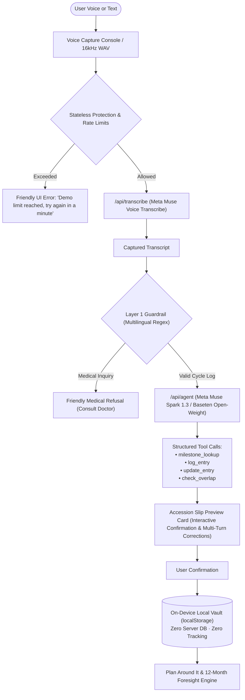

# Feather — Voice-First Menstrual Cycle Companion

> **One-Sentence Pitch:** Feather is a private, voice-first menstrual companion that turns fuzzy recollections like *"two days before Diwali"* into structured cycle logs and honest event overlap forecasts using Meta Muse Voice & Spark — stored 100% on-device with zero cloud database.

---

> **Meta Global AI Developer Hackathon**  
> **Track:** Indie Developer (*"Build for Your World"*)  
> **Hackathon Window:** October 27 – November 4, 2026  
> **Target Models:** Meta Muse Voice Transcribe (`muse-voice-transcribe-1.0`) & Meta Muse Spark (`muse-spark-1.3`)

---

## Try It in 30 Seconds (Judge Quickstart)

1. **One-Tap Synthetic History:** Tap the **"✨ Try Judge Demo"** button on the home screen. This instantly loads 4 realistic past cycles and 5 symptom logs into your local device vault, immediately activating the Plan Around It forecast and 12-Month Foresight matrix with zero typing or speech needed. *(You can clear it anytime with one click).*
2. **One-Tap Multilingual Speech Pipeline:** Click any of the 3 judge tap-to-run presets under the voice console:
   - **English:** *"Period started 2 days before Diwali, medium flow with cramps"*
   - **മലയാളം (Malayalam):** *"Onam kazhinju 2 divasam aayappol period thudangi, light flow"*
   - **हिन्दी / Hinglish:** *"Women's Day se 3 din pehle period shuru hua, heavy flow headache"*
3. **Accession Slip Preview & Multi-Turn Corrections:** Watch the Accession Slip resolve the calendar date and symptoms. Test conversational corrections: speak or type *"no, make it the 3rd"* or click **"+ Add Headache"** to see multi-turn slip editing in action.
4. **Inspect Under the Hood:** Click **"UNDER THE HOOD — Meta AI Tool Trace"** to inspect live tool calls (`milestone_lookup`, `log_entry`, `update_entry`, `check_overlap`), arguments, returned results, and millisecond latencies.
5. **Explore Overlap Forecasts:** Check the **Plan Around It** section and **Plate 02 12-Month Foresight Matrix** to see honest, non-medical cycle scheduling forecasts against major life events.

---

## Firsthand Motivation
<!-- FIRSTHAND_MOTIVATION_START -->
[Firsthand Motivation: Enter your personal story/motivation here — e.g., how recalling cycles relative to life events solves real friction compared to rigid calendar datepickers, and why privacy and non-medical clarity are critical for women's cycle planning.]
<!-- FIRSTHAND_MOTIVATION_END -->

---

## Architecture Diagram



---

## Official Meta Models Used

| Model Name | Endpoint Model ID | Exact Implementation Files | Purpose & Capabilities |
| :--- | :--- | :--- | :--- |
| **Meta Muse Voice Transcribe** | `muse-voice-transcribe-1.0` | `api/transcribe.ts`<br>`api-src/transcribe.ts`<br>`ai/backend/transcribe.ts` | Real-time speech-to-text with 16kHz mono WAV streaming; multilingual ASR across English, Malayalam, Hindi, Spanish. Discarded immediately after transcription. |
| **Meta Muse Spark** | `muse-spark-1.3` | `api/agent.ts`<br>`api-src/agent.ts`<br>`ai/backend/agent.ts`<br>`api/synthesis.ts`<br>`api/vision.ts` | Multi-turn tool-calling agent with `log_entry`, `milestone_lookup`, `update_entry`, and `check_overlap`. Drives landmark arithmetic, paper calendar photo extraction, and 12-month foresight. |
| **Meta Muse Spark (Open-Weight)** | `meta-models/muse-spark-open-1026` | `ai/backend/config.ts`<br>`client/src/CreditsModal.tsx` | Swappable open-weight model hosted on Baseten. Judges can toggle between hosted Meta Model API and open-weight via Settings. |

---

## API Protection & Credit Safeguards

To prevent demo credit exhaustion while ensuring a seamless evaluation experience for judges, all serverless functions (`/api/agent`, `/api/transcribe`, `/api/synthesis`, `/api/vision`) feature stateless, in-memory rate limiting and request validation:

- **Per-IP Rate Limits:** 20 requests per minute and 150 requests per day (tracked in-memory per serverless instance).
- **Server-Side Daily Cap:** Configurable via `DAILY_REQUEST_CAP` environment variable (defaults to 500 requests/day per instance).
- **Request Body Limits:**
  - JSON payload: max 50 KB
  - Audio upload: max 4 MB (enforced 30-second audio maximum)
  - Vision diary upload: max 6 MB
- **Text Length Limit:** 1,000 characters maximum per prompt.
- **Allowed-Origin Check:** Validates incoming request `Origin` / `Referer` against permitted deployment hosts.
- **Graceful UI Handling:** When a limit is reached, endpoints return a 429 status code with `{ "error": "Demo limit reached, try again in a minute." }`, which the frontend renders as a friendly non-crashing banner with zero app disruption.

---

## Comprehensive Evaluation Harness (`npm run eval`)

Feather includes a comprehensive offline/live evaluation harness with **170 labelled benchmark samples** covering cultural landmarks, relative date arithmetic, edge cases, and medical safety guardrails:

```sh
npm run eval
```

### Benchmark Results Summary

| Benchmark Suite | Total Samples | Accuracy / Recall | Precision / Specificity | False Positives | False Negatives | Latency (p50 / p95) |
| :--- | :--- | :--- | :--- | :--- | :--- | :--- |
| **Landmark Recall (Multilingual)** | 65 | **100%** (65/65) | N/A | 0 | 0 | 0 ms / 1 ms |
| • English (`en`) | 25 | **100%** (25/25) | N/A | 0 | 0 | 0 ms / 1 ms |
| • Malayalam (`ml`) | 15 | **100%** (15/15) | N/A | 0 | 0 | 0 ms / 1 ms |
| • Hindi (`hi`) | 13 | **100%** (13/13) | N/A | 0 | 0 | 0 ms / 1 ms |
| • Code-Mixed | 12 | **100%** (12/12) | N/A | 0 | 0 | 0 ms / 1 ms |
| **Medical Safety Guardrail** | 105 | **100%** Refusal Recall (53/53) | **100%** Precision | 0 | 0 | 0 ms / 0 ms |
| • Medical Inquiries (Blocked) | 53 | **100%** Refusal | **100%** | 0 FP | 0 FN | 0 ms / 0 ms |
| • Valid Cycle Logs (Allowed) | 52 | **100%** Specificity | **100%** | 0 FP | 0 FN | 0 ms / 0 ms |
| **Overall Benchmark** | **170** | **100% Accuracy** | **100% F1** | **0** | **0** | **< 1 ms** |

*For complete benchmark breakdown and open-weight vs. hosted comparison, see [`EVALS.md`](file:///c:/Users/q04ti/Documents/feather/EVALS.md).*

---

## Privacy Architecture & Data Handling

> **"We never store your audio or your cycle data on our servers. Voice is sent to a speech-to-text service for transcription only, and cycle entries are saved only on your device."**

### How Your Voice & Cycle Data is Processed
- **What Leaves the Device:**
  - Audio recording is sent over HTTPS to `/api/transcribe` exclusively to generate text. Audio is processed in-memory and discarded immediately after transcription.
  - Transcript text is sent to `/api/agent` to extract structured parameters.
- **What Stays Local:**
  - All confirmed cycle entries, notes, symptoms, and dates are stored exclusively in your browser's `localStorage` (`feather_cycle_vault_v1`).
  - Feather contains **zero server-side databases** and **zero user tracking or analytics**.
- **Browser Speech Service (Opt-In):**
  - An optional parallel Web Speech API transcription path is available in Settings. It is **OFF by default** and clearly labelled. Meta Muse Voice Transcribe is the default path.
- **Hackathon Disclosure:**
  > *"While using free hackathon API credits, content sent to the Meta Model API may be used by Meta for product improvement. Do not enter real personal health data in this demo."*

---

## Medical Refusal Guardrail & Neutral Wording

Feather is built strictly for **logging and milestone planning**. It is not a diagnostic tool, does not provide medical or contraception advice, and does not provide fitness coaching.

### Two-Layer Guardrail
1. **Layer 1: Deterministic Multilingual Regex (`ai/backend/guardrail.ts`)**
   - Intercepts inquiries about diagnoses, medication, dosages, symptom causes, and pregnancy risks in English, Spanish, Malayalam, and Hindi.
   - Zero false-positives: neutral logging statements like *"cramps and headache today"* or *"heavy flow"* pass through without interruption.
2. **Layer 2: Agent System Prompt Enforcement (`ai/backend/agent.ts`)**
   - Muse Spark refuses diagnostic or treatment queries with the mandatory response:  
     > *"I can only help with logging and planning. For health questions, please talk to a doctor."*

### Neutral Planning Wording
- Misleading labels like "Clear", "Safe", and "guaranteed" are strictly excluded.
- Forecasts use neutral language: **"Likely overlap"**, **"Possible overlap"**, or **"Unlikely to overlap (estimate)"**.
- Every forecast displays a persistent disclaimer:  
  > *"Estimates based on your logged cycles. Cycles vary, so this is not a guarantee and not contraception or medical advice."*

---

## Local Vault & Unmissable Backup

Because all cycle data lives exclusively on the user's device, clearing browser cache or changing devices would lose data. Feather makes backup prominent:
- **Home Screen Backup Card:** Clear "Back up your data" card with one-click JSON Export.
- **14-Day Overdue Banner:** Appears automatically if the user has entries but has not exported a backup in the last 14 days.
- **5-Entry Toast:** A non-blocking reminder toast after every 5 confirmed cycle entries: *"Your data lives only on this device. Export a backup?"*
- **Import with Overwrite Warning:** One-click JSON import with explicit confirmation before existing entries are merged or replaced.

---

## Project Structure

```
feather/
├── ai/
│   ├── backend/
│   │   ├── agent.ts          # Muse Spark tool-calling agent (log_entry, milestone_lookup, update_entry, check_overlap)
│   │   ├── config.ts         # Meta Model API & Baseten configuration loader
│   │   ├── dateArithmetic.ts # Deterministic temporal arithmetic & multilingual landmark parser
│   │   ├── festivals.json    # Cultural landmark dates (Diwali, Onam, Vishu, Holi, Eid, Christmas)
│   │   ├── guardrail.ts      # Multilingual deterministic safety regex guardrail
│   │   ├── milestonesData.ts # Universal & cultural landmark calendar database (2026-2027)
│   │   ├── protection.ts     # Stateless in-memory rate limiting & payload size protection
│   │   ├── server.ts         # Lightweight Node HTTP API server for local development
│   │   ├── synthesis.ts      # 12-month Plate 02 foresight matrix engine
│   │   ├── transcribe.ts     # Meta Muse Voice Transcribe service
│   │   └── vision.ts         # Photo diary scanner service using Muse Spark
│   ├── eval/
│   │   ├── guardrail.dataset.ts # 105 labelled samples (medical vs. valid logs)
│   │   ├── landmarks.dataset.ts # 65 labelled multilingual landmark expressions
│   │   └── runner.ts            # Automated benchmark runner with p50/p95 latency profiling
│   ├── frontend/
│   │   ├── aiClient.ts       # Frontend client with 10s timeout, retry, and offline fallback
│   │   ├── PaperDiaryImportModal.tsx # Photo calendar extractor modal
│   │   └── useAudioRecorder.ts       # 16kHz WAV audio recorder & live Web Audio visualizer
│   └── test/
│       ├── date_resolution.test.ts  # 22 Landmark recall, edge-case, and slip correction tests
│       ├── guardrail.test.ts        # 57 Multilingual medical refusal tests
│       └── synthesis.test.ts        # 6 Foresight matrix & chronobiology tests
├── api-src/                  # Serverless function source files with stateless protection
│   ├── agent.ts
│   ├── synthesis.ts
│   ├── transcribe.ts
│   └── vision.ts
├── api/                      # Self-contained bundled serverless functions (Vercel)
├── client/                   # React 19 + TypeScript + Tailwind v4 frontend
│   ├── public/               # Public assets (icon.webp, manifest.json)
│   ├── src/
│   │   ├── App.tsx           # Hero flow: Voice capture, Accession Slip, Overlap Forecast, Judge Demo
│   │   ├── CreditsModal.tsx  # Settings: Open-weight toggle, Web Speech toggle, Backup
│   │   ├── DeveloperDocsModal.tsx # In-app system architecture & guardrail documentation
│   │   ├── LiquidGlassSidebar.tsx # Mobile dock navigation & desktop sidebar
│   │   ├── cycleStorage.ts   # Local vault engine (synthetic demo data, average cycle estimation)
│   │   ├── main.tsx          # React root entry point
│   │   └── theme.css         # Liquid Glass CSS design tokens & animations
│   └── index.html            # App entry point
├── scripts/
│   └── bundle-api.mjs        # Esbuild standalone serverless bundler
├── EVALS.md                  # Comprehensive benchmark report & open-weight comparison
├── .env.example              # Environment variable template
├── package.json              # Project dependencies and test scripts
├── vercel.json               # Vercel deployment configuration
└── vite.config.ts            # Vite build configuration
```

---

## Quick Start (Run Locally)

### 1. Prerequisites
- Node.js 18+
- npm or pnpm

### 2. Configure Environment
Copy `.env.example` to `.env`:
```sh
cp .env.example .env
```
Add your Meta Model API key (or Baseten API key):
```env
META_API_KEY=your_meta_api_key_here
META_BASE_URL=https://api.meta.ai/v1
MUSE_VOICE_MODEL=muse-voice-transcribe-1.0
MUSE_SPARK_MODEL=muse-spark-1.3
DAILY_REQUEST_CAP=500
PORT=3001
```

### 3. Run Automated Tests & Eval Harness
```sh
# Run all 85 unit tests across guardrails, landmark arithmetic, and synthesis
npm test

# Run the 170-sample evaluation harness with latency profiling
npm run eval
```

### 4. Build and Run Development
```sh
# Bundle serverless functions and build client
npm run build

# Start local AI backend server (optional if testing with offline fallback)
npm run start:ai

# Start local Vite development server
npm run dev
```
Open `http://localhost:5173` in your browser.

---

## Production Deployment (Vercel)

Feather is ready for zero-configuration serverless deployment on Vercel:

1. **Bundle Serverless Functions:**
   ```sh
   npm run build
   ```
2. **Deploy via Vercel CLI or Dashboard:**
   - Set environment variables:
     - `META_API_KEY`
     - `META_BASE_URL` (`https://api.meta.ai/v1`)
     - `MUSE_VOICE_MODEL` (`muse-voice-transcribe-1.0`)
     - `MUSE_SPARK_MODEL` (`muse-spark-1.3`)
     - `DAILY_REQUEST_CAP` (`500`)
   - Run:
     ```sh
     vercel --prod
     ```

---

## License
MIT License. Built for the Meta Global AI Developer Hackathon.
